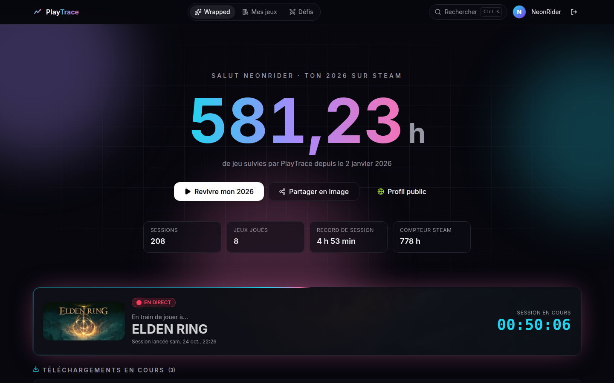
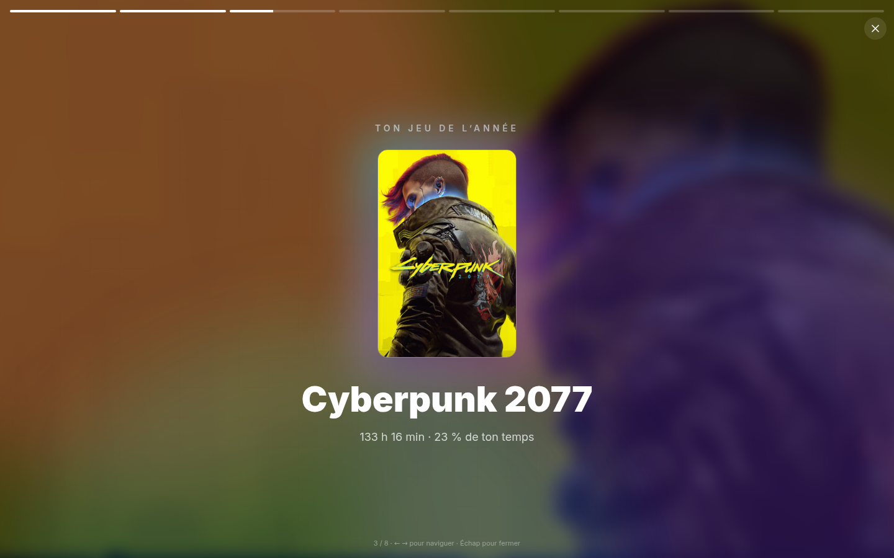
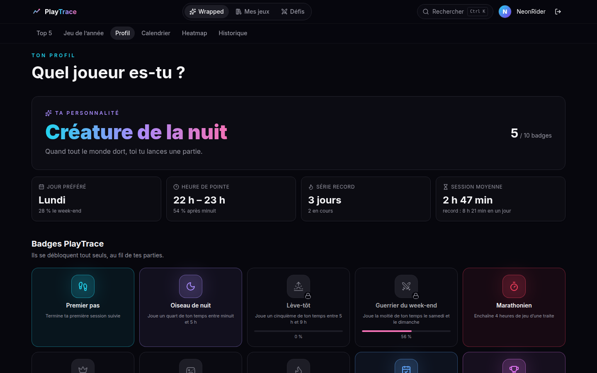
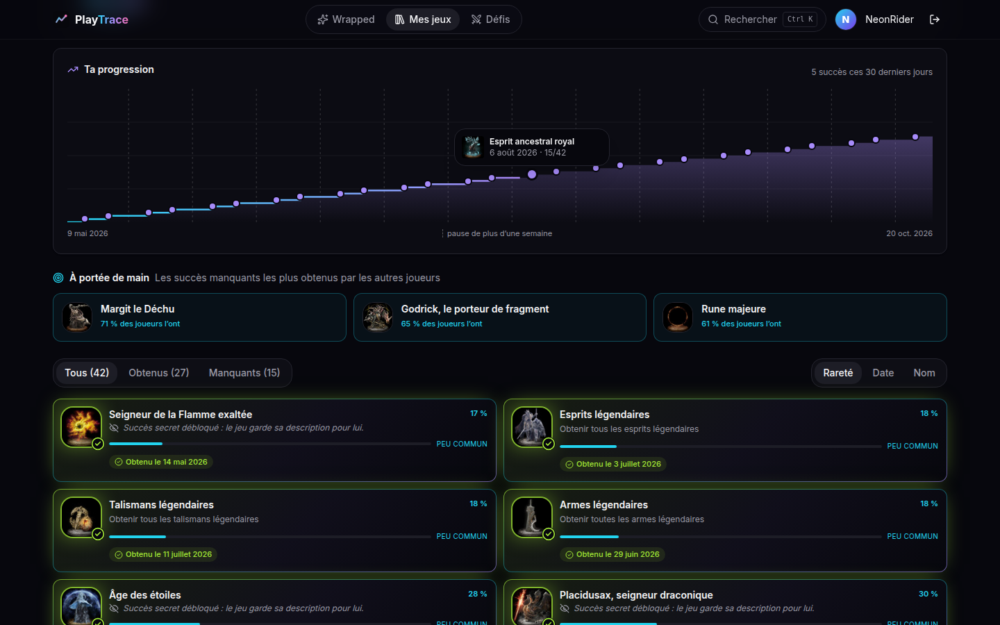
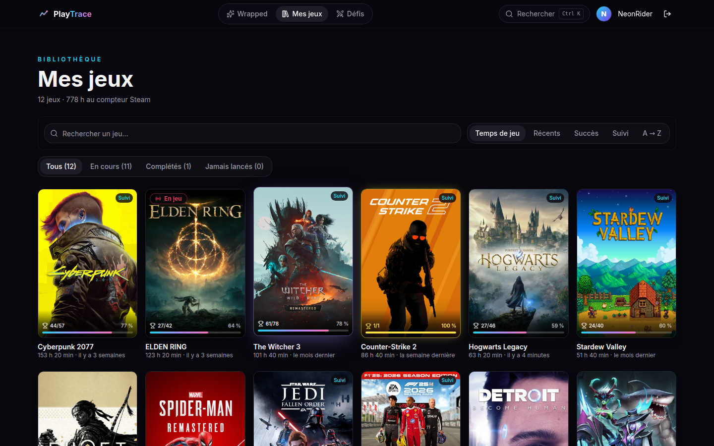
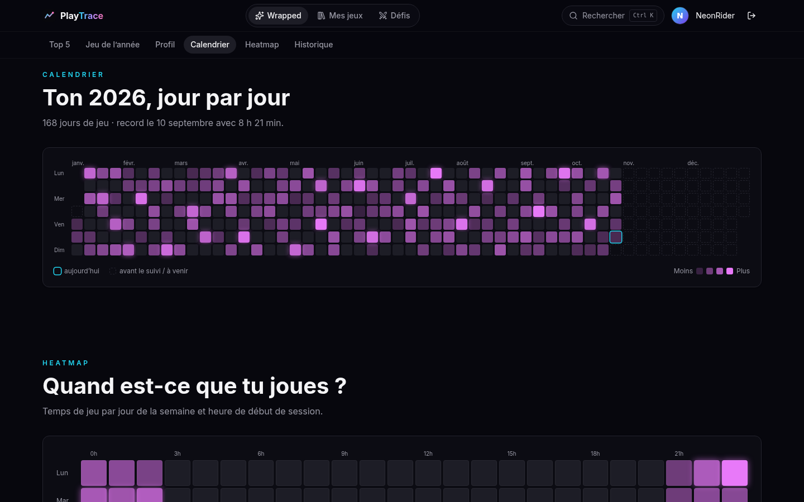
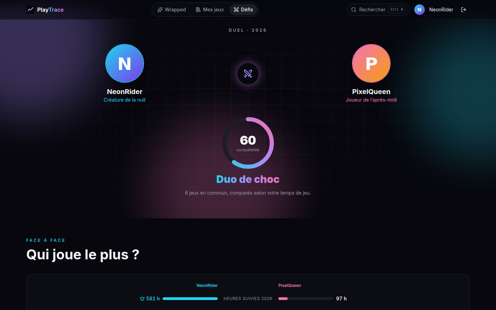
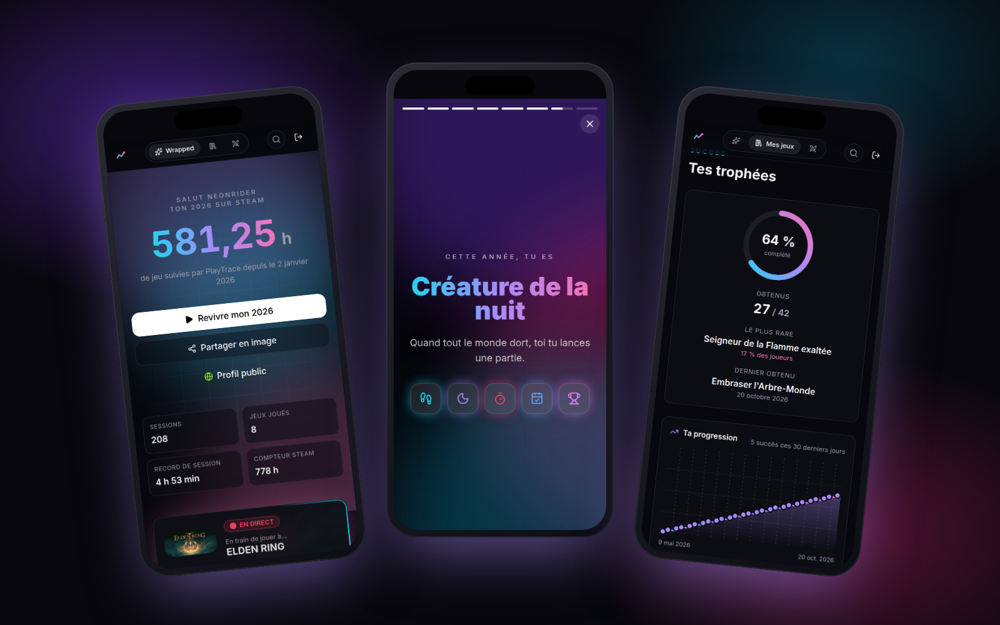
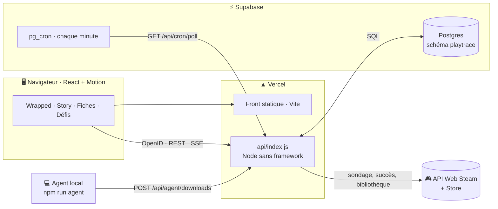

<div align="center">



<br />

**PlayTrace détecte ce que tu joues sur Steam, enregistre chaque session et transforme ton année de jeu en un Wrapped animé, qui se met à jour pendant que tu joues.**

<br />

[](https://play-trace-nine.vercel.app)


[Fonctionnalités](#-fonctionnalités) · [Captures](#-en-images) · [Architecture](#%EF%B8%8F-architecture) · [Installation](#-installation) · [Déploiement](#%EF%B8%8F-déploiement) · [Vie privée](#-sécurité--vie-privée)

</div>

<br />



<sub>Toutes les captures utilisent des joueurs de démonstration fictifs.</sub>

---

## 💡 Le concept

Steam te donne un total d'heures par jeu, mais **aucun historique** : impossible de savoir quand tu as joué, combien de temps a duré ta dernière session, ou à quoi ressemble ton année.

PlayTrace comble ce vide : il sonde Steam **chaque minute**, enregistre chaque session (jeu, début, fin, durée) et en tire un **Wrapped vivant**, façon Spotify, où le compteur d'heures grimpe pendant que tu joues.

> Le suivi tourne côté serveur : **ferme l'onglet, éteins ton PC**, tes parties sont quand même enregistrées.

---

## ✨ Fonctionnalités

<table>
  <tr>
    <td width="50%" valign="top">
      <h3>🔴 Le Wrapped en direct</h3>
      Compteur d'heures qui monte en temps réel, bandeau <b>« En train de jouer à… »</b> avec chrono, top 5, jeu de l'année, marquee des jaquettes, sélecteur d'année.
    </td>
    <td width="50%" valign="top">
      <h3>🎬 Le mode Story</h3>
      Ton année racontée en slides plein écran, façon stories : heures, jeu de l'année, top 5, créneau favori, records, personnalité. Tap, appui long, flèches du clavier.
    </td>
  </tr>
  <tr>
    <td valign="top">
      <h3>🧠 Ton profil de joueur</h3>
      Une personnalité calculée (<i>Créature de la nuit</i>, <i>Marathonien</i>, <i>Guerrier du week-end</i>…), ton jour et ton heure préférés, tes séries de jours, et <b>10 badges PlayTrace</b> à débloquer.
    </td>
    <td valign="top">
      <h3>📅 Calendrier & heatmap</h3>
      L'année jour par jour à la GitHub, et la heatmap jour × heure (en tranches de 3 h sur mobile) pour voir <i>quand</i> tu joues vraiment.
    </td>
  </tr>
  <tr>
    <td valign="top">
      <h3>🏆 Une fiche par jeu</h3>
      Succès <b>obtenus / manquants</b> avec leur rareté mondiale, succès <b>« à portée de main »</b>, courbe de progression, infos du Store, Metacritic et tes sessions sur ce jeu.
    </td>
    <td valign="top">
      <h3>📚 Toute ta bibliothèque</h3>
      Recherche sans accents, tris (temps, récents, succès, suivi, A → Z), filtres <i>En cours / Complétés / Jamais lancés</i> et le % de succès sur chaque jaquette.
    </td>
  </tr>
  <tr>
    <td valign="top">
      <h3>⚔️ Défis entre amis</h3>
      Profil public optionnel partageable par lien, et <b>duel</b> : score de compatibilité, face-à-face, jeux en commun, et les favoris de ton ami que tu n'as pas.
    </td>
    <td valign="top">
      <h3>🖼️ Ton Wrapped en image</h3>
      Une image au format story (1080 × 1920) avec ton avatar, tes heures, ton jeu de l'année, ton top 5 et ta personnalité. Partage natif sur mobile.
    </td>
  </tr>
  <tr>
    <td valign="top">
      <h3>📥 Téléchargements Steam</h3>
      Les jeux que ton client Steam télécharge, met à jour ou installe : progression, vitesse, temps restant. Lus sur ton PC par un petit agent local.
    </td>
    <td valign="top">
      <h3>⚡ Et tout le confort</h3>
      Recherche rapide <kbd>Ctrl</kbd> + <kbd>K</kbd>, notifications de fin de session, mode démarrage pour les nouveaux joueurs, appli <b>installable (PWA)</b>, responsive de 320 à 1920 px.
    </td>
  </tr>
</table>

---

## 📸 En images

<table>
  <tr>
    <td width="50%"><p align="center"><b>Mode Story</b> · le Wrapped en slides</p></td>
    <td width="50%"><p align="center"><b>Profil de joueur</b> · personnalité et badges</p></td>
  </tr>
  <tr>
    <td><p align="center"><b>Fiche jeu</b> · succès, rareté, progression</p></td>
    <td><p align="center"><b>Mes jeux</b> · bibliothèque et % de succès</p></td>
  </tr>
  <tr>
    <td><p align="center"><b>Calendrier</b> · l'année jour par jour</p></td>
    <td><p align="center"><b>Duel</b> · compatibilité et face-à-face</p></td>
  </tr>
</table>



---

## 🏗️ Architecture



| Pièce | Rôle |
|---|---|
| **Sondage** | `pg_cron` (Supabase) appelle `/api/cron/poll` chaque minute ; un seul appel `GetPlayerSummaries` couvre tous les joueurs (100 par requête). |
| **Sessions** | Ouvertes et fermées à chaque changement de jeu ; une coupure du serveur ne compte jamais comme du jeu (`last_seen_at`). |
| **Temps réel** | SSE : flux continu en local, reconnexion toutes les 15 s sur Vercel (fonctions éphémères). |
| **Caches** | Bibliothèque 1 h, progression des succès 6 h, fiches Store et succès 7 j, rareté 1 j, visuels 7 j. |
| **Visuels** | `/api/art/:appid/:type` résout les nouvelles URL du CDN Steam (fichiers avec hash) et redirige, mise en cache par le CDN de Vercel. |
| **En local** | `npm run server` fait tout dans un seul process : sondage, SSE continu et lecture directe des téléchargements Steam. |

---

## 🧱 Stack

| Couche | Technologies |
|---|---|
| Front | **React 18**, **Vite 5**, routeur maison (API History) |
| Style | **Tailwind CSS**, composants **shadcn/ui** |
| Animations | **Motion** (motion.dev), effets inspirés de React Bits, Aceternity UI, Magic UI |
| Back | **Node.js sans framework** (module `http`), une seule fonction Vercel |
| Base | **PostgreSQL** (Supabase), driver `postgres`, schéma dédié `playtrace` |
| Planification | `pg_cron` + `pg_net` |
| Données | API Web Steam, API du Store, fichiers `appmanifest_*.acf` du client Steam |
| Logos | `simple-icons` (CC0) · police Inter Variable |

---

## 🔒 Sécurité & vie privée

- 🔑 **Clé API Steam uniquement côté serveur**, jamais envoyée au navigateur.
- 🪪 **Steam OpenID** vérifié côté serveur (`check_authentication`), avec un état anti-CSRF et des **nonces anti-rejeu** stockés en base.
- 🍪 Session dans un **cookie signé HMAC**, `HttpOnly`, `SameSite=Lax`, `Secure` en HTTPS.
- 🧱 Requêtes SQL **paramétrées**, rôle Postgres **dédié** limité au schéma `playtrace` (non exposé par l'API REST de Supabase).
- 🛡️ En-têtes de sécurité : **CSP** stricte, `X-Frame-Options`, `nosniff`, `Referrer-Policy`, `Permissions-Policy`, HSTS.
- 🚦 **Limitation de requêtes** par IP, jetons secrets pour le cron et l'agent (comparés en temps constant).
- 🌍 **Profil public désactivé par défaut.** Activé, il ne montre que des agrégats (heures, top 5, personnalité, badges, calendrier) : **jamais** le détail ni les horaires des sessions, la partie en cours ou les téléchargements.

> ⚠️ La minification ralentit l'inspection du code client mais ne le protège pas : tout ce qui arrive dans le navigateur est lisible. **Seul ce qui reste sur le serveur est réellement protégé.**

---

## 🚀 Installation

> **Prérequis** : Node.js 22+, une clé API Steam ([steamcommunity.com/dev/apikey](https://steamcommunity.com/dev/apikey)) et une base Postgres (Supabase gratuit).

```bash
git clone https://github.com/LaFicelleCmoi/PlayTrace.git
cd PlayTrace
npm install
cp .env.example .env   # puis renseigne STEAM_API_KEY et DATABASE_URL
```

Crée le schéma avec [`server/schema.sql`](server/schema.sql), puis lance l'API et le front dans deux terminaux :

```bash
npm run server
```

```bash
npm run dev
```

Ouvre **http://localhost:5173** et connecte-toi avec Steam.

<details>
<summary><b>📋 Variables d'environnement</b></summary>

| Variable | Rôle |
|---|---|
| `STEAM_API_KEY` | Clé API Web Steam (obligatoire) |
| `DATABASE_URL` | Postgres, pooler Supabase en mode transaction (port 6543) |
| `SESSION_SECRET` | Au moins 32 caractères aléatoires, signe les cookies |
| `BASE_URL` | URL vue par le navigateur (`http://localhost:5173` en local) |
| `PORT` | Port du serveur Node local (3000) |
| `POLL_INTERVAL_MS` | Fréquence du sondage local (60 000, minimum 30 000) |
| `CRON_SECRET` | Jeton exigé par `/api/cron/poll` |
| `AGENT_TOKEN` · `AGENT_URL` | Jeton et site cible de l'agent des téléchargements |
| `STEAM_PATH` · `STEAM_LOCAL_STEAMID` | Optionnels : dossier du client Steam et compte associé (détectés automatiquement) |

</details>

<details>
<summary><b>📜 Scripts npm</b></summary>

| Script | Effet |
|---|---|
| `npm run dev` | Front Vite avec proxy vers l'API |
| `npm run server` | API Node locale (sondage + SSE + téléchargements), rechargée à chaque modification |
| `npm run agent` | Envoie les téléchargements de ton client Steam au site déployé |
| `npm run build` | Build de production du front |
| `npm start` | Serveur Node de production qui sert aussi le front (`dist/`) |

</details>

---

## ☁️ Déploiement

**Vercel + Supabase**, chaque push sur `main` redéploie automatiquement.

1. **Supabase** : exécute [`server/schema.sql`](server/schema.sql), crée un rôle `playtrace_app` limité au schéma `playtrace`, active `pg_cron` et `pg_net`, puis programme le sondage :
   ```sql
   SELECT cron.schedule('playtrace-poll', '* * * * *', $$
     SELECT net.http_get(
       url := 'https://<ton-site>/api/cron/poll',
       headers := jsonb_build_object('Authorization', 'Bearer <CRON_SECRET>')
     ) $$);
   ```
2. **Vercel** : importe le dépôt (preset Vite). [`vercel.json`](vercel.json) envoie `/api/*` et `/auth/*` vers [`api/index.js`](api/index.js), en région `cdg1` (Paris), et sert le front pour `/jeux`, `/defis`, `/joueur/*` et `/duel/*`.
3. **Variables Vercel** : `STEAM_API_KEY`, `DATABASE_URL`, `SESSION_SECRET`, `CRON_SECRET`, `AGENT_TOKEN`, `BASE_URL`.
4. **Téléchargements** (optionnel) : sur le PC qui a Steam, avec le même `AGENT_TOKEN` :
   ```bash
   npm run agent
   ```

<details>
<summary><b>🔌 Routes de l'API</b></summary>

| Méthode | Route | Rôle |
|---|---|---|
| `GET` | `/auth/steam` · `/auth/steam/return` | Connexion Steam OpenID |
| `POST` | `/auth/logout` | Déconnexion |
| `GET` | `/api/me` | Joueur connecté |
| `POST` | `/api/me/public` | Active / désactive le profil public |
| `GET` | `/api/stats?year=&tz=` | Stats de l'année, heatmap, calendrier, bibliothèque |
| `GET` | `/api/sessions` | Dernières sessions |
| `GET` | `/api/live` | Flux SSE : partie en cours et téléchargements |
| `GET` | `/api/games` | Bibliothèque complète |
| `GET` | `/api/games/achievements` | Progression des succès de chaque jeu |
| `GET` | `/api/games/:appid` | Fiche d'un jeu : Store, temps, sessions, succès |
| `GET` | `/api/art/:appid/:type` | Redirection vers le bon visuel Steam |
| `GET` | `/api/public/:steamid` | Profil public (sans connexion) |
| `GET` | `/api/duel/:steamid` | Duel avec un profil public |
| `GET` | `/api/cron/poll` | Sondage Steam (jeton `CRON_SECRET`) |
| `POST` | `/api/agent/downloads` | Téléchargements envoyés par l'agent (jeton `AGENT_TOKEN`) |

</details>

---

## 📁 Structure

```
PlayTrace/
├── api/index.js              # fonction Vercel unique
├── server/
│   ├── app.js                # routes, communes au local et à Vercel
│   ├── index.js              # serveur Node local (sondage + SSE continus)
│   ├── agent.js              # agent local des téléchargements
│   ├── poller.js · sessions.js · stats.js
│   ├── games.js · library.js · social.js
│   ├── steam.js              # API Web Steam et Store
│   ├── auth.js · security.js # OpenID, cookies, CSP, limitation
│   ├── downloads.js · vdf.js # client Steam local (.acf / .vdf)
│   ├── sse.js · static.js · users.js · config.js · db.js
│   └── schema.sql            # schéma Postgres
├── src/
│   ├── pages/                # Wrapped, Library, GameDetail, Challenges, Duel, PublicProfile
│   ├── components/           # Hero, LiveBanner, WrappedStory, Achievements, Footer…
│   │   └── ui/               # shadcn/ui + composants animés
│   ├── hooks/                # useLiveStatus (SSE), useStats, useApi…
│   └── lib/                  # router, insights, shareImage, toast, install…
├── public/                   # manifeste PWA, service worker, icônes
├── docs/                     # bannière et captures du README
└── vercel.json
```

---

## ⚠️ Bon à savoir

- Le **profil Steam** et les **détails des jeux** doivent être **publics** (Steam → Modifier le profil → Confidentialité) pour la détection du jeu en cours et les succès.
- L'historique précis commence **à l'activation du suivi** : un Wrapped est vraiment riche après quelques semaines.
- Environ **100 000 requêtes / jour** par clé Steam : un sondage par minute en consomme ~1 440, quel que soit le nombre de joueurs (100 par requête).
- Les **téléchargements** ne sont visibles que si `npm run server` ou `npm run agent` tourne sur le PC qui a Steam.

---

## 🗺️ Roadmap

- [x] Back : OpenID, sondage, stockage des sessions
- [x] Temps réel (SSE) et bandeau live
- [x] Front React : Wrapped, animations, responsive
- [x] Stats avancées : heatmap, calendrier, profil de joueur, badges
- [x] Fiches jeux, succès et bibliothèque
- [x] Sécurisation et déploiement (Vercel + Supabase)
- [x] Export image, profil public et duel entre amis
- [x] PWA installable
- [ ] Répartition par genre

---

## 👤 Auteur

**LaFicelleCmoi** : étudiant à EPITECH Marseille, passionné de jeux vidéo, d'animes, de nouvelles technologies et de Formule 1.

<div align="center">

<br />

*Fait avec ☕, du néon et beaucoup de parties de Steam.*

<sub>PlayTrace est un projet indépendant, non affilié à Valve. Données fournies par l'API Web Steam.</sub>

</div>
